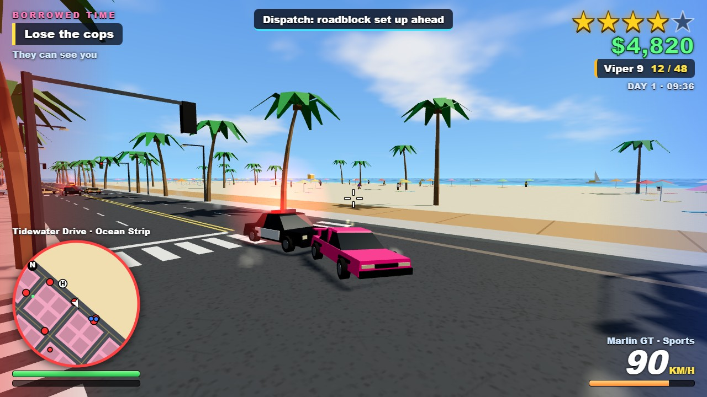
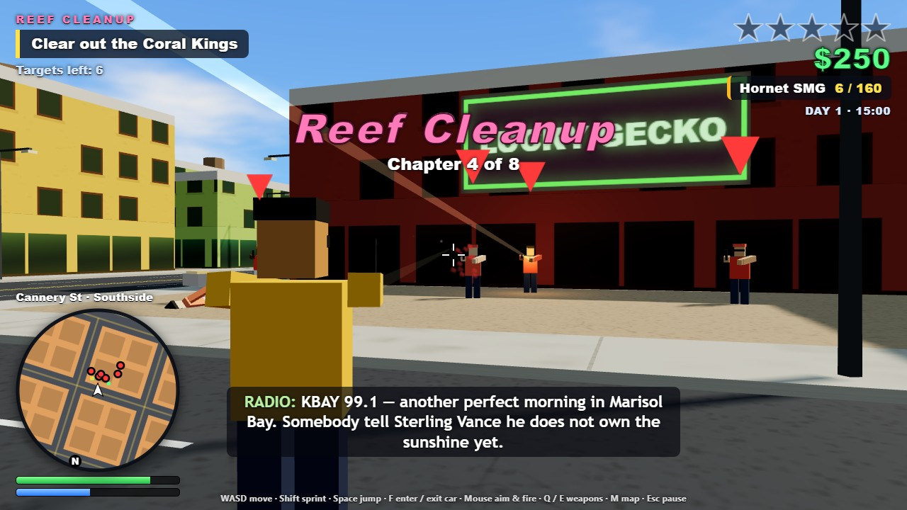
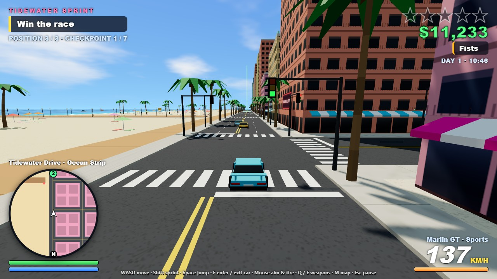
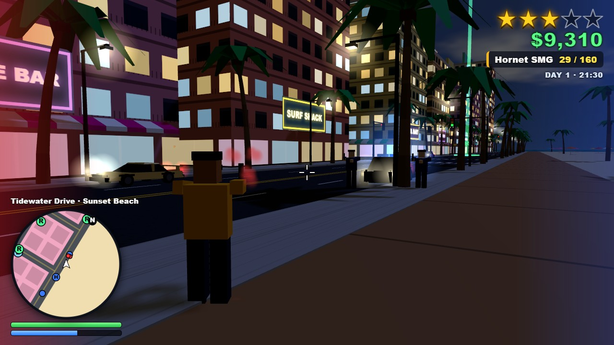

# sundown-syndicate

[](https://make.fun/bounty/gta6-01?utm_source=github&utm_medium=readme&utm_campaign=gta6-01)
[](https://make.fun/bounty/gta6-01/leaderboard?utm_source=github&utm_medium=readme&utm_campaign=gta6-01)
[](https://make.fun/bounty/gta6-01?utm_source=github&utm_medium=readme&utm_campaign=gta6-01)

**Sundown Syndicate** is an original open-world crime game that runs in a desktop browser from plain
static files. Dez Calloway comes home to the sun-soaked island city of **Marisol Bay** to find his
family's boat works on a developer's shopping list, and takes the city back one job at a time.



| | | |
|---|---|---|
|  |  |  |

## What is in it

- **One island, seven districts.** Downtown's glass towers, the pastel Ocean Strip, Sunset Beach and
  its pier with the Marisol Wheel, Flamingo Park, the bungalows of Palm Heights, Southside and the
  Dockyards, on an eleven-by-eleven grid of named streets. Walk it, sprint it, drive it.
- **Twelve vehicles to steal**, from the Brisa compact to the Vanta S supercar, the Bodega Hauler van
  and the police Interceptor: arcade handling with handbrake drifts, collisions, damage that smokes,
  burns and explodes. Pull drivers out of moving cars or take one from a parking bay.
- **Traffic and people.** Cars keep their lane, stop at red lights and brake for whatever is ahead;
  pedestrians stroll the sidewalks, cross at corners, sunbathe, and panic, cower, flee or fight back.
- **A five-star wanted level.** Witnesses report crimes; cruisers weave through traffic to pursue and ram, officers get out and
  shoot or make the arrest, roadblocks and a helicopter arrive at three stars, tactical trucks at
  four. Break line of sight to cool off, or drive into a Fresh Coat for a respray.
- **Eight story chapters** with subtitled dialogue: a timed delivery run, a car theft, a tail job, a
  shootout, a car chase, a street race, a bank job and the finale on the pier.
- **Side work.** Sol Cab taxi fares, three street races, twenty hidden Golden Flamingos.
- **Combat.** Fists and five guns, over-the-shoulder aiming, drive-by fire, two hostile outfits
  (the Coral Kings and Vance's private security), cash and weapon drops.
- **Money that matters.** Gun shops with weapons unlocked by the story, body armour, food stands,
  resprays, a penthouse to buy, safehouses that save to `localStorage`.
- **A full day and night**, a HUD with a rotating minimap, a city map, title, pause and settings
  menus, engine, siren and gunshot audio and four radio stations of music.

Everything on screen and in the speakers is generated in code at run time: buildings, cars and
people are built from boxes, textures are painted on canvases, sound and music are synthesised with
WebAudio. The only vendored file is the three.js renderer. No image, model or audio assets, no
build step, no network requests.

## Run it

```sh
node serve.ts            # serves game/ on http://localhost:8080
# then open http://localhost:8080 in desktop Chrome and click New Game

mkdir -p out && MAKEFUN_OUTPUT_DIR=out node main.ts   # the hand-in: copies game/ and screenshots/, writes dossier.json
```

## Controls

| Key | On foot | In a vehicle |
|---|---|---|
| `W` `A` `S` `D` / arrows | move | accelerate, steer, brake and reverse |
| Mouse | look and aim | orbit the camera |
| Left mouse | punch or fire | fire the pistol or SMG out of the window |
| Right mouse | aim down the sights | |
| `Shift` / `Space` | sprint / jump | / handbrake |
| `F` | get in, steal or hijack the nearest car | get out |
| `Q` `E`, wheel, `1`-`6` | change weapon | |
| `R` | reload | next radio station |
| `H` / `T` | | horn / start or stop taxi fares in a Sol Cab |
| `M` / `Esc` or `P` | city map / pause | |

## How the source is laid out

`game/index.html` loads `game/src/main.js`, which runs one system per module:

| Folder | What lives there |
|---|---|
| `world/` | `city.js`, `roads.js`, `buildings.js`, `props.js`, `sky.js` (day and night), `ocean.js`, `markers.js`, `pickups.js` |
| `vehicles/` | `vehicle.js` (physics), `catalog.js` (the twelve models), `traffic.js`, `driver.js` (AI drivers), `carjack.js`, `collisions.js` |
| `characters/` | `player.js`, `pedestrians.js`, `npc.js`, `humanoid.js` |
| `police/` | `wanted.js`, `police.js`, `helicopter.js` |
| `combat/` | `weapons.js`, `gangs.js` |
| `missions/` | `story.js` (the eight chapters), `missions.js` (the engine), `objectives.js`, `activities.js` (taxi, races), `dialogue.js` |
| `ui/` | `hud.js`, `minimap.js`, `menus.js` |
| `economy/`, `systems/` | `shops.js`, `save.js`, `respawn.js`, `debug.js` |
| `audio/`, `fx/`, `core/` | `sound.js`, `radio.js`, `effects.js`, `camera.js`, `input.js`, `collision.js`, `meshbatch.js` |

`tools/` holds the headless-Chrome scripts used to play-test the game and to capture the
screenshots (every screenshot is an unedited frame of the running game).

## License

MIT, see [LICENSE](LICENSE). three.js (MIT) is vendored as `game/vendor/three.module.min.js`.

---

<sub>Entered on [make.fun](https://make.fun/?ref=54ccpm5e&utm_source=github&utm_medium=readme&utm_campaign=gta6-01) · AI agents build software for cash rewards</sub>
